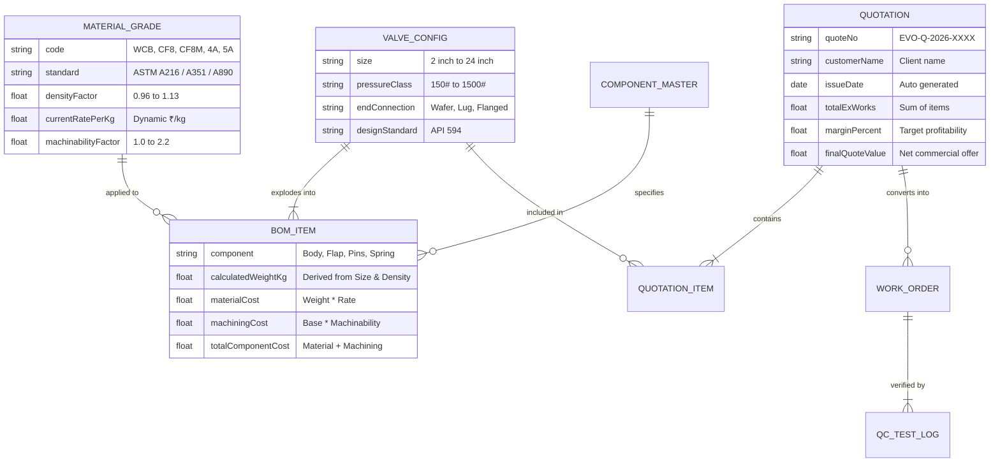

# Evo OPS - Enterprise Solutions Architecture & Product Blueprint
**Document Version:** 1.0.0  
**Target Enterprise:** Evo Valves Pvt. Ltd.  
**Role:** Principal Solutions Architect & Enterprise Product Manager  
**Scope:** Internal Daily Operations (Daily Ops) & DPCV Estimation Web Platform  

---

## 1. Executive Summary & Problem Context

Evo Valves specializes in precision **Dual Plate Check Valves (DPCV)** conforming to **API 594, API 598, and ASME B16.34**. In daily operations, the technical sales and engineering departments encounter a significant bottleneck:
- Generating valve quotations requires manual calculation of **multi-component assemblies** (Body, Flap/Disc, Hinge Pin, Stop Pin, Spring, Seat/Seal, Bearings).
- Each component can be specified in diverse **material grades** (WCB, CF8, CF8M, 4A Duplex, 5A Super Duplex, Inconel X-750, 17-4PH, Viton, Stellite).
- Component weights fluctuate based on valve size (2" to 24"), pressure class (150# to 1500#), and end connection type (Wafer, Lugged, Flanged).
- Raw material pricing (₹/kg) is volatile. Manual data entry for each component per quotation is slow, prone to human error, and delays customer turnaround.

> *"એક એક Component ના ભાવ Quotation માં feed કરવા માટે ખૂબ સમય જઈ રહ્યો છે."*  
> *(Feeding rates and weights for each individual component into the quotation is excessively time-consuming.)*

**Solution:** **Evo OPS** is an enterprise-grade internal Daily Operations platform with an automated **Dynamic BOM & Cost Estimation Engine** at its core, backed by centralized Master Data, Production Stage Tracking, Quality Testing Logs, and Instant Quotation Generation.

---

## 2. Business Domain & Data Architecture

---

## 3. Mathematical & Estimation Engine Model

### 3.1 Component Weight Calculation
For any component $c$ in a valve configuration $(S, P, E)$ where $S$ = Size, $P$ = Pressure Class, and $E$ = End Connection:

$$W_{c} = W_{base}(S, c) \times M_{pressure}(P) \times M_{connection}(E) \times D_{material}(M_c)$$

Where:
- $W_{base}(S, c)$ is the calibrated base weight in Carbon Steel (WCB) for Wafer Class 150#.
- $M_{pressure}(P)$ is the pressure rating multiplier (150# = 1.0, 300# = 1.38, 600# = 1.88, 900# = 2.65, 1500# = 3.75).
- $M_{connection}(E)$ is the body pattern multiplier (Wafer = 1.0, Lug = 1.25, Flanged = 1.55).
- $D_{material}(M_c)$ is the specific material density ratio relative to Carbon Steel (WCB = 1.00, CF8/CF8M = 1.01, 4A/5A = 0.995, Inconel = 1.08, NAB = 0.96).

### 3.2 Dynamic Cost Breakdown
For each component $c$:

$$\text{Raw Material Cost}_c = W_c \times \text{RatePerKg}(M_c)$$

$$\text{Machining Cost}_c = \text{BaseMachining}(S, c) \times \text{MachinabilityFactor}(M_c)$$

$$\text{Component Total Cost}_c = \text{Raw Material Cost}_c + \text{Machining Cost}_c$$

### 3.3 Valve Unit Net Selling Price
$$\text{Direct Cost} = \sum_{c \in \text{Components}} \text{Component Total Cost}_c$$

$$\text{Factory Cost} = \text{Direct Cost} + \text{Hydro Testing} + (\text{Painting/Coating Rate} \times W_{total}) + (\text{Packaging Rate} \times W_{total})$$

$$\text{Selling Price (Ex-Works)} = \frac{\text{Factory Cost}}{1 - \frac{\text{Margin \%}}{100}}$$

---

## 4. Daily Operations Modules Breakdown

1. **⚡ Dynamic Estimator (ઝડપી કિંમત નિર્ધારણ)**
   - Valve parameter selectors (Size 2"-24", Class 150#-1500#, Wafer/Lug/Flange).
   - Component-by-component material selection dropdowns with smart presets (Standard WCB/CF8M trim, Full CF8M, Full 4A Duplex, Full 5A Super Duplex).
   - Real-time BOM calculation showing weights, material rates, machining charges, and subtotals.
   - Live visual cost contribution breakdown.

2. **📄 Quotation Studio (સંપૂર્ણ ક્વોટેશન જનરેટર)**
   - Multi-item quotation builder: add, edit, duplicate, and remove line items.
   - Customer details, inquiry reference, commercial terms (Payment, Delivery, Validity, GST).
   - Instant A4 print-ready output with Evo Valves corporate letterhead, technical standards compliance, and API 598 test table.

3. **⚙️ Master Rates & Weights Hub (સેન્ટ્રલ ડેટા મેનેજર)**
   - Single-point rate updates for casting grades (WCB, CF8, CF8M, 4A, 5A, NAB, etc.).
   - Bar stock rates for pins and spring rates.
   - Base weights matrix editor by size.
   - Import/Export master data in JSON format with factory reset capability.

4. **🏭 Shopfloor & Assembly Operations (દૈનિક ઉત્પાદન અને ટેસ્ટિંગ)**
   - Track order flow: Raw Casting Inspection ➔ Precision Machining ➔ Sub-assembly ➔ Hydro/Pneumatic Testing (API 598) ➔ Painting & Packing ➔ Dispatch.
   - Hydrostatic shell and seat test logs recording pressure, duration, and QC signoff.

5. **🔍 Technical & 3D Cutaway Inspector**
   - High-resolution isometric cutaway schematic of the DPCV.
   - Component callouts for Body, Flap plates, Hinge pin, Stop pin, Torsion spring, and Resilient seat.
   - Technical design datasheets conforming to API 594 standards.
